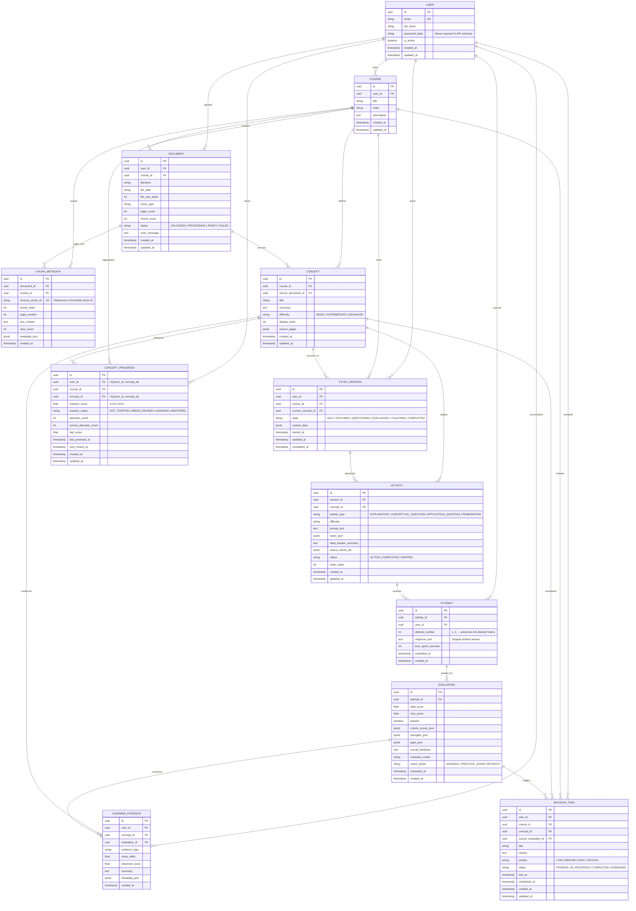

# Study Partner AI — Database Design

## 1. Storage Architecture Overview
Study Partner AI uses a hybrid persistence architecture:
1. **PostgreSQL 16 (Relational Database):** System of record for users, courses, uploaded document metadata, chunk relational metadata, extracted concepts, study sessions, learning activities, immutable student attempts, rubric evaluations, learning evidence, per-concept mastery progress, and scheduled revision tasks. Managed via **SQLAlchemy 2.0** (`DeclarativeBase` + `Mapped[...]` annotations) and **Alembic** migrations.
2. **ChromaDB (Vector Database):** Stores dense vector embeddings (`384` dimensions via `all-MiniLM-L6-v2`) and similarity search indices. Vector arrays are **not** duplicated in PostgreSQL; instead, `chunk_metadata.chroma_vector_id` links relational chunk metadata to its vector in ChromaDB.

---

## 2. Entity-Relationship Diagram (12 Core Entities)

---

## 3. Relational Table Specifications & Ownership Rules

All 12 tables use `UUID` (`Uuid(as_uuid=True)`) primary keys and timezone-aware UTC timestamps (`TIMESTAMPTZ`).

### 3.1 `users` (`app/models/user.py`)
- **Purpose:** Student account identity and ownership root.
- **Columns:** `id` (PK), `email` (Unique, Indexed), `full_name`, `password_hash` (PBKDF2-HMAC-SHA256 hash), `is_active`, `created_at`, `updated_at`.
- **Security Rule:** `UserRead` Pydantic schema strictly omits `password_hash`.

### 3.2 `courses` (`app/models/course.py`)
- **Purpose:** Course workspace owned by a student user.
- **Columns:** `id` (PK), `user_id` (FK $\rightarrow$ `users.id` ON DELETE CASCADE), `title`, `code`, `description`, `created_at`, `updated_at`.
- **Indexes:** `ix_courses_user_id`, `ix_courses_user_title`.

### 3.3 `documents` (`app/models/course.py`)
- **Purpose:** Uploaded PDF file metadata and ingestion lifecycle state.
- **Columns:** `id` (PK), `user_id` (FK $\rightarrow$ `users.id` ON DELETE CASCADE), `course_id` (FK $\rightarrow$ `courses.id` ON DELETE CASCADE), `filename`, `file_path`, `file_size_bytes`, `mime_type`, `page_count`, `chunk_count`, `status` (`UPLOADED`, `PROCESSING`, `READY`, `FAILED`), `error_message`, `created_at`, `updated_at`.
- **Indexes:** `ix_documents_user_id`, `ix_documents_course_id`, `ix_documents_status`.

### 3.4 `chunk_metadata` (`app/models/course.py`)
- **Purpose:** Relational metadata for extracted PDF text chunks without storing vector arrays in PostgreSQL.
- **Columns:** `id` (PK), `document_id` (FK $\rightarrow$ `documents.id` ON DELETE CASCADE), `course_id` (FK $\rightarrow$ `courses.id` ON DELETE CASCADE), `chroma_vector_id` (Unique, Indexed), `chunk_index`, `page_number`, `text_content`, `char_count`, `metadata_json`, `created_at`.
- **Indexes:** `ix_chunk_metadata_document_id`, `ix_chunk_metadata_course_id`, `ix_chunk_metadata_chroma_vector_id` (Unique), `ix_chunk_metadata_doc_page`.

### 3.5 `concepts` (`app/models/course.py`)
- **Purpose:** Core academic concepts extracted from course documents.
- **Columns:** `id` (PK), `course_id` (FK $\rightarrow$ `courses.id` ON DELETE CASCADE), `source_document_id` (FK $\rightarrow$ `documents.id` ON DELETE SET NULL), `title`, `summary`, `difficulty`, `display_order`, `source_pages`, `created_at`, `updated_at`.
- **Indexes:** `ix_concepts_course_id`, `ix_concepts_source_document_id`, `ix_concepts_course_order`.

### 3.6 `study_sessions` (`app/models/session.py`)
- **Purpose:** State-machine-driven interactive study session.
- **Columns:** `id` (PK), `user_id` (FK $\rightarrow$ `users.id` ON DELETE CASCADE), `course_id` (FK $\rightarrow$ `courses.id` ON DELETE CASCADE), `current_concept_id` (FK $\rightarrow$ `concepts.id` ON DELETE SET NULL), `state`, `context_data`, `started_at`, `updated_at`, `completed_at`.
- **Indexes:** `ix_study_sessions_user_id`, `ix_study_sessions_course_id`, `ix_study_sessions_current_concept_id`, `ix_study_sessions_state`.

### 3.7 `activities` (`app/models/session.py`)
- **Purpose:** Pedagogical activity (explanation, conceptual question, application question, remediation) within a `StudySession`.
- **Columns:** `id` (PK), `session_id` (FK $\rightarrow$ `study_sessions.id` ON DELETE CASCADE), `concept_id` (FK $\rightarrow$ `concepts.id` ON DELETE CASCADE), `activity_type`, `difficulty`, `prompt_text`, `rubric_json`, `ideal_answer_summary`, `source_chunk_ids`, `status`, `order_index`, `created_at`, `updated_at`.
- **Indexes:** `ix_activities_session_id`, `ix_activities_concept_id`, `ix_activities_activity_type`.

### 3.8 `attempts` (`app/models/session.py`)
- **Purpose:** Immutable record of a student's submitted answer to an `Activity`. Multiple attempts per activity are preserved chronologically (`attempt_number = 1, 2, ...`).
- **Columns:** `id` (PK), `activity_id` (FK $\rightarrow$ `activities.id` ON DELETE CASCADE), `user_id` (FK $\rightarrow$ `users.id` ON DELETE CASCADE), `attempt_number`, `response_text`, `time_spent_seconds`, `submitted_at`, `created_at`.
- **Indexes:** `ix_attempts_activity_id`, `ix_attempts_user_id`, `ix_attempts_activity_attempt_num`.

### 3.9 `evaluations` (`app/models/session.py`)
- **Purpose:** Rubric-based evaluation of a student `Attempt`. Supports multiple evaluations per attempt to preserve full grading history.
- **Columns:** `id` (PK), `attempt_id` (FK $\rightarrow$ `attempts.id` ON DELETE CASCADE), `concept_id` (FK $\rightarrow$ `concepts.id` ON DELETE SET NULL), `verdict` (`CORRECT | PARTIALLY_CORRECT | INCORRECT | OFF_TOPIC | INSUFFICIENT_EVIDENCE`), `total_score` (exposed also as `rubric_score`), `max_score`, `passed`, `criteria_scores_json`, `strengths_json` (`strengths`), `gaps_json` (`gaps`), `misconception` (nullable, populated only when backed by evidence), `evidence_json` (`evidence`), `confidence` (`0.0–1.0`), `next_activity`, `error_classification` (`NONE | INCOMPLETE_REASONING | FACTUAL_MISTAKE | CALCULATION_ERROR | AMBIGUOUS_OR_VAGUE | OFF_TOPIC`), `uncertain_evaluation`, `prompt_version`, `overall_feedback`, `evaluator_model`, `coach_action`, `evaluated_at`, `created_at`.
- **Indexes:** `ix_evaluations_attempt_id`, `ix_evaluations_concept_id`, `ix_evaluations_verdict`, `ix_evaluations_coach_action`.

### 3.10 `learning_evidences` (`app/models/learning.py`)
- **Purpose:** Granular evidence record linking an evaluation outcome to a concept's mastery trajectory.
- **Columns:** `id` (PK), `user_id` (FK $\rightarrow$ `users.id` ON DELETE CASCADE), `concept_id` (FK $\rightarrow$ `concepts.id` ON DELETE CASCADE), `evaluation_id` (FK $\rightarrow$ `evaluations.id` ON DELETE SET NULL), `evidence_type`, `score_delta`, `observed_score`, `summary`, `metadata_json`, `created_at`.
- **Indexes:** `ix_learning_evidences_user_id`, `ix_learning_evidences_concept_id`, `ix_learning_evidences_evaluation_id`, `ix_learning_evidences_user_concept`.

### 3.11 `concept_progress` (`app/models/learning.py`)
- **Purpose:** Per-user, per-concept mastery score (`0.0–100.0`), status (`NOT_STARTED`, `NEEDS_REVIEW`, `LEARNING`, `MASTERED`), and attempt counters.
- **Constraints & Indexes:** `uq_concept_progress_user_concept` (`UNIQUE(user_id, concept_id)`), `ix_concept_progress_user_id`, `ix_concept_progress_course_id`, `ix_concept_progress_concept_id`, `ix_concept_progress_mastery_status`.

### 3.12 `revision_tasks` (`app/models/learning.py`)
- **Purpose:** Scheduled remediation or spaced-repetition review task generated from rubric gaps.
- **Columns:** `id` (PK), `user_id` (FK $\rightarrow$ `users.id` ON DELETE CASCADE), `course_id` (FK $\rightarrow$ `courses.id` ON DELETE CASCADE), `concept_id` (FK $\rightarrow$ `concepts.id` ON DELETE CASCADE), `source_evaluation_id` (FK $\rightarrow$ `evaluations.id` ON DELETE SET NULL), `title`, `reason`, `priority` (`LOW`, `MEDIUM`, `HIGH`, `CRITICAL`), `status` (`PENDING`, `IN_PROGRESS`, `COMPLETED`, `DISMISSED`), `due_at`, `completed_at`, `created_at`, `updated_at`.
- **Indexes:** `ix_revision_tasks_user_id`, `ix_revision_tasks_course_id`, `ix_revision_tasks_concept_id`, `ix_revision_tasks_status`, `ix_revision_tasks_priority`, `ix_revision_tasks_due_at`.
