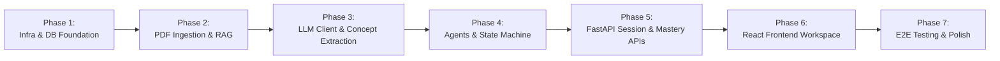

# Study Partner AI — Development Roadmap

## 1. Phased Implementation Strategy
To minimize integration risk and ensure every layer is verified before higher-level components depend on it, development is divided into **7 small, testable phases**. Each phase produces a working, verifiable increment.

---

## 2. Implementation Dependencies Matrix

| Phase | Depends On | Key Deliverables | Verification Gate |
| :--- | :--- | :--- | :--- |
| **Phase 1: Infrastructure & Relational DB** | None | `docker-compose.yml`, FastAPI skeleton, SQLAlchemy 2.0 models, initial Alembic migration, `/health` endpoint | `pytest` DB model tests & `docker compose up` health check |
| **Phase 2: PDF Ingestion & Vector Store (RAG)** | Phase 1 | PyMuPDF extractor, recursive text chunker, Sentence Transformers embedder, ChromaDB wrapper | `pytest` unit tests for PDF extraction, chunking metadata, and Chroma retrieval |
| **Phase 3: LLM Client & Document Concept Extraction** | Phase 1, Phase 2 | Ollama client with Pydantic JSON schema validation + retry, `ConceptExtractor`, `IngestionService`, Course & Document API endpoints | `pytest` ingestion flow creating `Document`, `Concept`, and `MasteryRecord` rows |
| **Phase 4: Core AI Agents & State Machine** | Phase 2, Phase 3 | `TutorAgent`, `AssessmentAgent`, `LearningCoachAgent`, `MasteryService`, deterministic `Orchestrator` state machine | `pytest` unit & state transition tests across `IDLE -> TEACHING -> QUESTIONING -> EVALUATING -> COACHING` |
| **Phase 5: Session & Mastery REST APIs** | Phase 4 | FastAPI routers for `/concepts` and `/sessions` (`start`, `practice`, `submit-answer`, `next-step`) | `pytest` FastAPI `TestClient` integration suite covering full session lifecycle |
| **Phase 6: React + TypeScript Frontend** | Phase 5 | Vite + Tailwind UI: Course Manager, PDF Uploader, Concept Mastery List, Interactive Study Session UI, Rubric Feedback Card | Component rendering & manual/automated workflow verification |
| **Phase 7: End-to-End Testing & Hardening** | Phase 6 | Playwright E2E test suite, error boundary states, Docker Compose full-stack verification | Green `pytest` suite + Green Playwright E2E suite |

---

## 3. Detailed Phase Breakdown

### Phase 1: Project Scaffolding, Infrastructure & Database Foundation
- **Goal:** Establish the repository structure, Docker Compose environment (PostgreSQL + ChromaDB), FastAPI application factory, SQLAlchemy 2.0 ORM models, and Alembic migrations.
- **Tasks:**
  1. Create `docker-compose.yml` for PostgreSQL 16 and ChromaDB (plus backend/frontend service definitions).
  2. Initialize `backend/` (`pyproject.toml`, `app/config.py`, `app/database.py`, `app/main.py`).
  3. Implement all 7 SQLAlchemy models (`Course`, `Document`, `Concept`, `MasteryRecord`, `StudySession`, `SessionMessage`, `Assessment`).
  4. Configure Alembic and generate the initial schema migration.
  5. Implement `GET /api/v1/health` and basic `/api/v1/courses` CRUD endpoints.
  6. Write `pytest` tests verifying database schema creation and course CRUD.

### Phase 2: PDF Extraction, Chunking & ChromaDB RAG Pipeline
- **Goal:** Build a reliable, fast local RAG pipeline using PyMuPDF, Sentence Transformers, and ChromaDB.
- **Tasks:**
  1. Implement `pdf_extractor.py` using `fitz` (PyMuPDF) to extract text per page and reject empty/corrupted PDFs.
  2. Implement `chunker.py` for overlapping text splitting (`chunk_size=800`, `chunk_overlap=150`) preserving `page_number`.
  3. Implement `embedder.py` using `sentence-transformers` (`all-MiniLM-L6-v2`).
  4. Implement `vector_store.py` for ChromaDB upsert, metadata-filtered similarity query, and deletion by `document_id` / `course_id`.
  5. Write `pytest` tests using a sample fixture PDF to verify extraction, chunking, embedding dimensions, and top-$k$ retrieval accuracy.

### Phase 3: Ollama Client, Concept Extraction & Ingestion API
- **Goal:** Connect the backend to Ollama with structured Pydantic output validation and complete the end-to-end PDF upload endpoint.
- **Tasks:**
  1. Implement `llm_client.py` wrapping Ollama `/api/chat` with structured JSON validation and automatic 2-step retry on malformed JSON.
  2. Implement `concept_extractor.py` to extract 3–8 core concepts (title, summary, difficulty, source pages) from document text.
  3. Implement `ingestion_service.py` coordinating PDF save $\rightarrow$ RAG indexing $\rightarrow$ Concept extraction $\rightarrow$ `MasteryRecord` initialization.
  4. Expose `POST /api/v1/courses/{course_id}/documents` and `GET /api/v1/courses/{course_id}/concepts`.
  5. Write `pytest` tests verifying the complete document upload and concept extraction pipeline.

### Phase 4: Pedagogical Agents & Python State Machine Orchestrator
- **Goal:** Implement the three specialized AI agents, deterministic mastery calculation, and the Python state machine orchestrator.
- **Tasks:**
  1. Implement `MasteryService` with the deterministic weighted mastery update formula and status transitions (`NOT_STARTED`, `NEEDS_REVIEW`, `LEARNING`, `MASTERED`).
  2. Implement `TutorAgent` (grounded explanation + page citations + remediation support).
  3. Implement `AssessmentAgent` (question & rubric generation + rubric-based grading).
  4. Implement `LearningCoachAgent` (pedagogical next-step decision: `ADVANCE`, `PRACTICE_AGAIN`, `RETEACH`).
  5. Implement `Orchestrator` state machine enforcing valid state transitions (`IDLE -> TEACHING -> QUESTIONING -> EVALUATING -> COACHING -> COMPLETED`).
  6. Write comprehensive `pytest` tests for mastery calculations, each agent's structured output schema, and invalid state transition guards.

### Phase 5: Study Session REST APIs
- **Goal:** Expose the Orchestrator workflow through clean, RESTful FastAPI endpoints.
- **Tasks:**
  1. Implement `session_service.py` to persist `StudySession`, `SessionMessage`, and `Assessment` records across state transitions.
  2. Implement `/api/v1/sessions` endpoints (`POST /courses/{id}/sessions`, `GET /sessions/{id}`, `POST /sessions/{id}/practice`, `POST /sessions/{id}/submit-answer`, `POST /sessions/{id}/next-step`).
  3. Write `pytest` integration tests simulating a full multi-turn student study session via HTTP.

### Phase 6: React + TypeScript + Tailwind Frontend
- **Goal:** Build an intuitive, responsive student interface that visualizes courses, concepts, interactive tutoring, rubric feedback, and mastery progress.
- **Tasks:**
  1. Scaffold `frontend/` with Vite, React 18, TypeScript, Tailwind CSS, and React Router.
  2. Build typed API client (`src/api/`) and TypeScript interfaces matching backend Pydantic schemas.
  3. Build **Course Dashboard & PDF Upload View** (upload progress, document list, concept mastery cards with progress bars).
  4. Build **Interactive Study Session View** with distinct visual panels for:
     - **Tutor Mode:** Markdown explanation, key takeaways, and source PDF page badges.
     - **Practice Mode:** Question prompt, rubric criteria preview, and answer text area.
     - **Evaluation & Coaching Mode:** Score badge, criterion-by-criterion rubric breakdown card, strengths/gaps lists, mastery delta indicator, and Learning Coach action buttons (`Practice Again`, `Re-explain Concept`, `Next Concept`).

### Phase 7: End-to-End Verification & Polish
- **Goal:** Verify the complete system through automated Playwright browser tests and Docker Compose validation.
- **Tasks:**
  1. Configure Playwright in `frontend/e2e/`.
  2. Write E2E tests covering: Course creation $\rightarrow$ PDF upload $\rightarrow$ Concept extraction view $\rightarrow$ Starting a study session $\rightarrow$ Requesting practice question $\rightarrow$ Submitting answer $\rightarrow$ Viewing rubric feedback & updated mastery score.
  3. Verify full stack startup and health via `docker compose up --build`.
