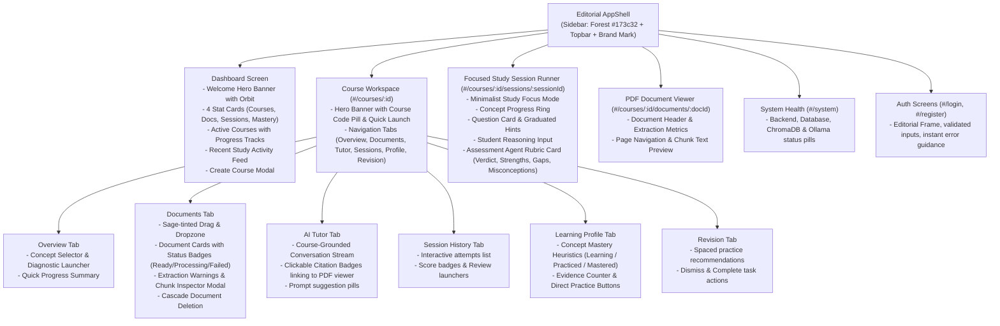

# Study Partner AI — Frontend Redesign Plan (Inspired by StudyMate)

**Date:** November 4, 2026  
**Status:** Approved for Implementation  
**Design Reference:** [StudyMate (TouaibiAhmed/StudyMate)](https://github.com/TouaibiAhmed/StudyMate)  
**Target Platform:** Study Partner AI (Adaptive, Local-First AI Learning Companion)

---

## 1. Executive Summary & Design Vision

This plan details the comprehensive UI/UX redesign of **Study Partner AI**, taking inspiration from the visual language, editorial typography, and aesthetic elegance of the **StudyMate** educational platform while strictly preserving:
- All existing Study Partner AI backend API contracts (`/api/v1/*`).
- Real-time PostgreSQL models, ChromaDB vector indexing, and PyMuPDF text ingestion.
- The grounded AI Tutor, multi-turn study sessions, rubric-based assessment agent, and adaptive learning coach.
- Zero mock data substitutions: all views connect directly to live backend endpoints.

### Visual Identity Matrix: StudyMate Inspiration Adapted to Study Partner AI

| Element | Current Study Partner AI | Redesigned (StudyMate Inspired) |
|---|---|---|
| **Theme Tone** | Generic SaaS indigo/slate | Warm Academic / Editorial Companion |
| **Typography** | Default system sans-serif | `Fraunces` (warm editorial display serif) + `DM Sans` (crisp modern body sans) |
| **Primary Palette** | Indigo (`#4f46e5`), Slate (`#0f172a`) | Academic Forest (`#173c32`), Botanical Ink (`#1d3029`), Cream Parchment (`#f7f3eb`), Warm Surface (`#fffdf8`) |
| **Accent Colors** | Blue / Emerald | Terracotta Coral (`#d96552`), Sage Green (`#8da78f`), Soft Lilac (`#a69bc4`) |
| **Layout Shell** | Simple topbar navigation | Dual-column app shell: Dark Forest Sidebar (248px) with coral active indicator + Editorial Topbar with user profile & search |
| **Elevation & Border** | Standard `border-slate-200` | Subtle organic lines (`#dedfd5`), soft warm shadows (`rgba(29, 48, 41, 0.06)`) |
| **Hero Elements** | Plain page titles | High-impact Forest Welcome Banner with orbital concentric rings & circular progress/streak orbit |
| **Cards & Panels** | Standard white boxes | Rich surface panels (`#fffdf8`) with tinted icon badges, progress tracks, and clean typography |

---

## 2. Component & Screen Architecture Mapping

Every existing Study Partner AI capability is mapped directly to a polished, StudyMate-inspired screen:

---

## 3. Detailed Screen Redesign Specifications

### 3.1 AppShell & Navigation
- **Sidebar**: Fixed 248px desktop width. Background: `--forest` (`#173c32`). Brand mark: terracotta coral square with book emblem + "Study Partner" title.
- **Nav Items**: Dashboard, My Courses, Learning Progress, System Status. Hover: soft white overlay (`#ffffff12`). Active: inset coral bar (`box-shadow: inset 3px 0 var(--coral)`).
- **User Footer**: Student avatar circle with initials, user name, email, and sign-out trigger.
- **Topbar**: Height 76px. Warm surface background (`#fffdf8`), border bottom (`#dedfd5`). Displays active section title in `Fraunces` serif + uppercase tracking eyebrow. Right actions: quick course filter, theme toggle, and status indicators.

### 3.2 Dashboard
- **Welcome Hero**: Rich forest green card with concentric decorative orbital rings (`welcome-card`), student name, inspirational study tagline, circular streak orbit counter, and primary "Start Studying" action button.
- **Stat Cards**: 4 responsive cards:
  1. *Total Courses* (Terracotta coral icon badge)
  2. *Ingested Documents* (Sage green icon badge)
  3. *Active Sessions* (Soft lilac icon badge)
  4. *Concepts Mastered* (Forest green icon badge)
- **Active Courses Grid**: Large course cards with colored banner tops (`forest`, `coral`, `sage`, `lilac`), course code badge, progress track (`.progress-track` with animated `.progress-fill`), and quick link to course workspace.
- **Recent Activities / Sessions**: Feed of recent evaluations with verdict badges (`CORRECT`, `PARTIALLY_CORRECT`), timestamps, and resume buttons.

### 3.3 Course Workspace & Tabs
- **Course Hero**: Deep banner displaying course code tag, course title in `Fraunces`, document count, and a prominent "Launch Study Session" button.
- **Tabs**: Polished underline navigation bar (`Overview`, `Documents`, `AI Tutor`, `Session History`, `Learning Profile`, `Revision`).
- **Documents Area**:
  - Sage-tinted dashed dropzone with clean upload icon.
  - Document rows with file size, page count, and status badges (`Ready` in emerald, `Processing` in amber, `Failed` in rose).
  - Chunk inspector modal with monospace passage preview and page ranges.
- **AI Tutor Interface**:
  - Chat stream with distinct student and AI bubbles.
  - Grounded source references rendered as interactive cards/pills with document filename and page numbers.
- **Learning Profile & Revision Views**:
  - Concept cards with mastery progress bars and evidence counts.
  - Spaced revision action items with urgency flags.

### 3.4 Interactive Study Session Runner
- **Focus Header**: Clean top bar with course title, active concept name, and "Exit Session" button.
- **Question Card**: Card with activity type pill (Diagnostic, Practice, Harder Practice, Transfer), question prompt in clear typography.
- **Hints Drawer**: Progressive graduated hints revealed on demand.
- **Answer Composer**: Thoughtful response textarea with character/reasoning counter and submit action.
- **Assessment Agent Results**:
  - High-impact verdict banner (`Correct`, `Partially Correct`, `Incorrect`).
  - Rubric score gauge (0–100%).
  - Strengths list (green checkmarks) & Identified Gaps list (coral alert icons).
  - Supported misconception callout (if evidenced).
  - Learning Coach next step recommendation with direct 1-click continuation.

---

## 4. Implementation Steps & Verification Strategy

1. **Tokens & Theme Foundation**:
   - Add Google Fonts (`DM Sans` and `Fraunces`) to `frontend/index.html` and Tailwind/CSS tokens.
   - Configure custom Tailwind color variables or CSS utility classes matching StudyMate (`--forest`, `--coral`, `--paper`, `--surface`, `--sage`, `--lilac`, `--ink`, `--line`).
2. **AppShell & Topbar Modernization**:
   - Upgrade `frontend/src/components/layout/AppShell.tsx` to the dual-column StudyMate layout.
   - Support mobile responsive toggle drawer.
3. **UI Primitives Upgrade**:
   - Modernize `Layout.tsx`, `States.tsx`, `StatusBadge.tsx`, and `AlertBanner.tsx`.
4. **Dashboard & Course Workspace Overhaul**:
   - Redesign `DashboardPage.tsx` with Welcome Hero Banner, Stat Cards, Course Grid, and Activity Feed.
   - Upgrade `CourseWorkspacePage.tsx` with Course Detail Hero and modern tabs.
5. **Feature Components Modernization**:
   - Upgrade `CourseCard.tsx`, `CreateCourseForm.tsx`, `DocumentList.tsx`, `PDFUploader.tsx`.
   - Upgrade `CourseTutorChat.tsx`, `StudySessionLauncher.tsx`, `SessionHistory.tsx`.
   - Upgrade `LearningProfileView.tsx`, `RevisionRecommendationsView.tsx`.
   - Upgrade `AssessmentFeedbackCard.tsx` and `StudySessionPage.tsx`.
6. **Full-Stack Verification**:
   - Static analysis (`npm run lint` $\rightarrow$ 0 errors).
   - Production bundle build (`npm run build` $\rightarrow$ 0 errors).
   - Playwright E2E suites verification.
   - Live backend API tests & demo run verification.
