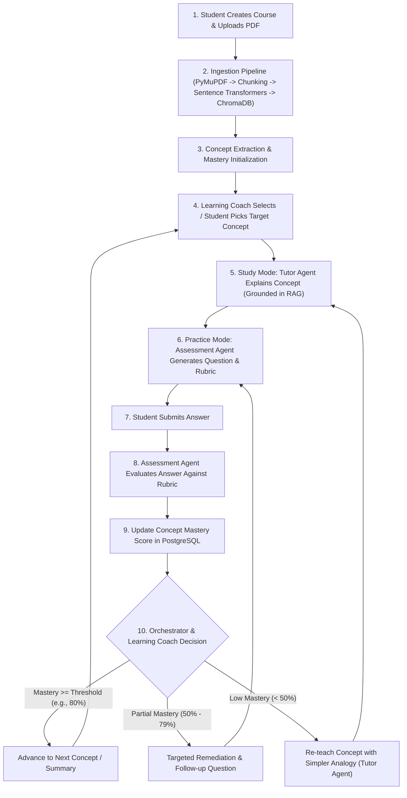

# Study Partner AI — Project Overview

## 1. Executive Summary
**Study Partner AI** is an adaptive, local-first AI learning companion designed for university students. Rather than acting as a generic chatbot that passively answers prompts, Study Partner AI structures the study process around uploaded course materials (PDFs). It extracts key concepts, guides students through interactive explanations, evaluates their comprehension using rubric-based assessments, and dynamically adapts study activities based on mastery levels.

## 2. Problem Statement
University students frequently struggle with:
- **Passive reading:** Reviewing lecture slides and textbooks without active recall or structured self-testing.
- **Unverified AI answers:** Generic LLMs hallucinate facts outside the syllabus or give away answers instead of fostering comprehension.
- **Lack of diagnostic feedback:** Students rarely receive granular, rubric-aligned feedback on open-ended conceptual questions before high-stakes exams.
- **Unclear study priorities:** Difficulty identifying which concepts are mastered and which require targeted remediation.

## 3. Core Value Proposition
- **Grounded in Course Material (RAG):** Every explanation, question, and evaluation rubric is anchored to the student's uploaded course PDFs via Retrieval-Augmented Generation.
- **Structured Multi-Agent Pedagogy:** Distinct AI roles (**Tutor Agent**, **Assessment Agent**, **Learning Coach**) coordinated by a deterministic **Python State Machine Orchestrator**.
- **Rubric-Based Formative Assessment:** Automated, transparent grading against explicit criteria (accuracy, completeness, terminology) with actionable remediation steps.
- **Adaptive Mastery Tracking:** Continuous tracking of concept-level mastery scores to recommend the optimal next learning activity.
- **Privacy & Local-First Execution:** Powered locally by **Ollama**, **Sentence Transformers**, and **ChromaDB**, eliminating per-token cloud API costs and keeping course documents private.

---

## 4. Target Users & Primary Use Cases
- **Target Audience:** Undergraduate and graduate university students studying concept-heavy or technical courses (Computer Science, Engineering, Biology, Economics, Law, etc.).
- **Core Use Cases:**
  1. **Course & Document Onboarding:** Create a course workspace, upload lecture notes/textbook chapters (PDF), and automatically extract a structured list of core concepts.
  2. **Guided Concept Study:** Select a concept to learn interactively with the **Tutor Agent**, which explains material using retrieved document chunks, analogies, and check-for-understanding prompts.
  3. **Formative Assessment:** Answer generated conceptual or application questions; receive structured, rubric-based scores and constructive feedback from the **Assessment Agent**.
  4. **Adaptive Remediation & Coaching:** Review mastery progress and receive personalized next-step recommendations (e.g., review prerequisites, retry with hints, advance to a new concept) from the **Learning Coach**.

---

## 5. Complete Student Learning Workflow

The end-to-end student journey follows a closed-loop mastery cycle:

---

## 6. Technology Stack Summary

| Layer | Technology | Purpose |
| :--- | :--- | :--- |
| **Frontend** | React 18, TypeScript, Vite, Tailwind CSS | Responsive SPA for document management, interactive study sessions, and mastery dashboards |
| **Backend API** | Python 3.11+, FastAPI, Pydantic v2 | RESTful API, request validation, background ingestion tasks, and session orchestration |
| **Relational DB** | PostgreSQL 16, SQLAlchemy 2.0, Alembic | Persistent storage for courses, documents, concepts, study sessions, assessments, and mastery records |
| **Vector DB** | ChromaDB | Persistent vector indexing and similarity search over chunked PDF embeddings |
| **Embeddings** | Sentence Transformers (`all-MiniLM-L6-v2`) | Local dense vector embedding generation for document chunks and retrieval queries |
| **PDF Extraction** | PyMuPDF (`fitz`) | Fast, layout-aware text and page metadata extraction from uploaded PDFs |
| **LLM Runtime** | Ollama (e.g., `llama3.1:8b` / `mistral`) | Local LLM inference for concept extraction, tutoring, question generation, and rubric evaluation |
| **AI Orchestration** | Python State Machine (MVP) | Deterministic workflow transitions across Tutor, Assessment, and Learning Coach agents (designed for optional future migration to LangGraph) |
| **Testing** | pytest, Playwright | Backend unit/integration testing and end-to-end browser workflow testing |
| **Infrastructure** | Docker Compose | Containerized orchestration for PostgreSQL, ChromaDB, Backend, Frontend, and Ollama integration |

---

## 7. MVP Scope Boundaries

### In Scope (MVP)
- Single-user local deployment (or simple profile selection without complex OAuth/multi-tenant RBAC).
- Course creation and text-based PDF upload/ingestion via PyMuPDF.
- Automatic extraction of key concepts per document/course.
- Vector indexing in ChromaDB using Sentence Transformers.
- State-machine-driven study sessions (`IDLE` -> `TEACHING` -> `QUESTIONING` -> `EVALUATING` -> `COACHING` -> `COMPLETED`).
- Rubric-based evaluation of short-answer / open-ended student responses with structured JSON output.
- Concept mastery score calculation and persistence in PostgreSQL.
- React UI featuring Course View, PDF Upload status, Interactive Study Session View, Rubric Feedback Card, and Mastery Progress View.

### Out of Scope (Post-MVP / Avoided Overengineering)
- Complex OCR for scanned handwritten PDFs.
- Multi-user authentication, billing, or cloud SaaS multi-tenancy.
- Real-time voice/video tutoring or collaborative multiplayer study rooms.
- Autonomous multi-agent loops without deterministic state bounds (preventing infinite LLM loops).
- Premature LangGraph complexity before the core Python state machine is validated.
