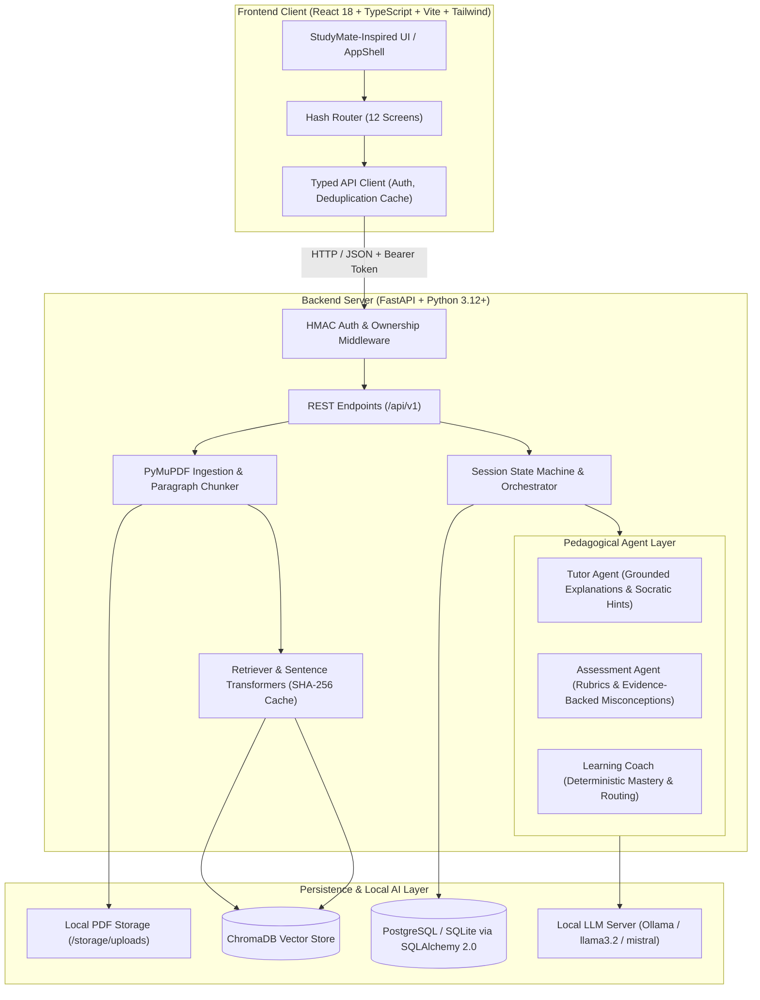

# Study Partner AI — Comprehensive System Architecture & Engineering Report

> **Target Audience:** Claude / Senior AI Engineers / System Architects  
> **Repository:** `Study Partner AI`  
> **Status:** Production-Ready & Verified (Phases 0–9 Complete)  
> **Last Updated:** November 2026

---

## 1. Executive Summary & Mission

**Study Partner AI** is an adaptive, local-first, pedagogical AI learning platform tailored for university students. Unlike generic conversational chatbots that hallucinate facts or passively provide answers without fostering understanding, Study Partner AI:
1. **Anchors learning strictly to uploaded course materials (PDFs)** using Retrieval-Augmented Generation (RAG).
2. **Enforces active recall and formative assessment** through structured, rubric-based grading.
3. **Implements a multi-agent pedagogical framework** coordinated by a **deterministic Python state machine** rather than unconstrained, hallucination-prone autonomous loops.
4. **Calculates concept mastery deterministically** using evidence-based heuristics (no direct LLM score mutation).
5. **Runs completely locally and privately** with Ollama, Sentence Transformers, and ChromaDB, safeguarding student data and eliminating per-token cloud costs.

---

## 2. High-Level System Architecture



---

## 3. Technology Stack

| Domain | Technology | Key Dependencies & Version Notes |
| :--- | :--- | :--- |
| **Backend Framework** | Python 3.12+, FastAPI, Uvicorn | High-performance asynchronous API framework |
| **ORM & Relational Database** | SQLAlchemy 2.0, Alembic, SQLite/PostgreSQL | Strict typing with Mapped columns, Alembic migrations |
| **PDF Extraction & Chunker** | PyMuPDF (`fitz`) | Page-aware text extraction, heading detection, scanned page warnings |
| **Vector Store & Embeddings** | ChromaDB, Sentence Transformers (`all-MiniLM-L6-v2`) | SHA-256 cached 384-dim embeddings; persistent vector storage |
| **Local LLM Engine** | Ollama (`llama3.2:3b`, `mistral:7b`) | REST API client with timeouts, retry logic, and fallback repair |
| **Frontend Framework** | React 18, TypeScript 5, Vite 6 | Feature-oriented directory structure, hash-based SPA routing |
| **Design System & Styling** | Tailwind CSS 3.4, PostCSS, Google Fonts | StudyMate aesthetic: Fraunces serif + DM Sans, Forest/Ink/Paper palette |
| **Testing & Quality Assurance**| Pytest, Playwright, ESLint 9 | 40 backend tests, 2 browser E2E suites, 18-case assessment benchmark |

---

## 4. Backend Architecture & Domain Services

The backend follows a **layered, domain-driven clean architecture**:
`api/routes/` $\rightarrow$ `services/` $\rightarrow$ `repositories/` $\rightarrow$ `models/` (DB) + `tutor/` / `assessment/` / `learning/` (AI).

### 4.1 Database Layer (SQLAlchemy 2.0 ORM)
All 12 models reside in `backend/app/models/` and are mirrored by clean Pydantic v2 schemas in `backend/app/schemas/`:

1. **`User`**: Student account (`id`, `email`, `password_hash`, `full_name`, `created_at`). Excludes `password_hash` on serialization.
2. **`Course`**: Course workspace (`id`, `user_id`, `code`, `title`, `description`). Owns documents, concepts, and sessions.
3. **`Document`**: Uploaded PDF (`id`, `course_id`, `filename`, `file_path`, `file_size_bytes`, `page_count`, `chunk_count`, `status`, `extraction_warnings`).
4. **`ChunkMetadata`**: Relational metadata for vector chunks (`id`, `document_id`, `chunk_index`, `page_start`, `page_end`, `section_title`, `chunk_text`, `char_length`).
5. **`Concept`**: Core knowledge unit (`id`, `course_id`, `title`, `description`, `source_pages`, `prerequisites`, `importance_rank`).
6. **`StudySession`**: Interactive session state (`id`, `course_id`, `user_id`, `status` [ACTIVE, IDLE, COMPLETED], `current_activity_id`, `summary`).
7. **`Activity`**: Question or explanation (`id`, `session_id`, `concept_id`, `activity_type`, `difficulty`, `question_text`, `rubric_id`, `hints`, `source_chunks`).
8. **`Attempt`**: Student submission (`id`, `activity_id`, `answer_text`, `hints_used`, `duration_seconds`, `idempotency_key`, `attempt_number`).
9. **`Evaluation`**: Rubric grading (`id`, `attempt_id`, `verdict`, `rubric_score`, `strengths`, `gaps`, `misconception`, `evidence`, `confidence`).
10. **`LearningEvidence`**: Immutable mastery audit log (`id`, `user_id`, `concept_id`, `activity_id`, `score`, `verdict`, `hints_used`, `timestamp`).
11. **`ConceptProgress`**: Aggregate mastery state (`id`, `user_id`, `concept_id`, `mastery_score`, `mastery_status`, `evidence_count`, `last_attempt_at`).
12. **`RevisionTask`**: Spaced practice recommendation (`id`, `user_id`, `concept_id`, `priority` [CRITICAL, HIGH, MEDIUM, LOW], `status` [PENDING, COMPLETED, DISMISSED]).

### 4.2 Ingestion & RAG Pipeline (`backend/app/ingestion/`, `retrieval/`)
1. **Validation (`validator.py`)**: Sanitizes filenames, enforces $\le 50\text{ MB}$ size, verifies `.pdf` extension, MIME type, and `%PDF-` magic bytes.
2. **Page-Aware Extraction (`extractor.py`)**: PyMuPDF extracts text per page, repairs broken hyphenations, normalizes whitespace, detects chapter/section headers, and flags scanned or low-text pages as warnings.
3. **Paragraph-Aware Chunker (`chunker.py`)**: Splits into overlapping segments (default: 800 characters, 150 overlap) without slicing mid-sentence. Attaches `page_start`, `page_end`, and `section_title`.
4. **Embedding Generation (`embeddings.py`)**: Encodes chunks into 384-dimensional dense vectors using `all-MiniLM-L6-v2`. Features an in-memory SHA-256 content-hash cache and a deterministic fallback for air-gapped environments.
5. **Persistent ChromaDB Storage (`vector_store.py`)**: Stores vectors alongside course and document metadata for scoped semantic queries (`query_similar`). Supports cascade deletion by course or document.
6. **Retriever (`retriever.py`)**: Performs semantic vector search with ownership filtering. Provides a graceful relational fallback (`ChunkMetadata`) if ChromaDB is offline.

### 4.3 Multi-Agent Pedagogical Framework

Study Partner AI adopts a strict **three-agent separation of concerns**:

#### 1. Tutor Agent (`backend/app/tutor/`)
- **Role:** Explains concepts and provides graduated hints without spoiling solutions.
- **Prompt Defense:** Wraps student material in clear boundary tags (`<source_document>`) with strict instructions forbidding prompt injection.
- **Citation Anchoring:** Extracts inline citations with page references (`[p. 4]`). Detects insufficient evidence when the query falls outside the syllabus.
- **Graduated Hints:** Returns Level 1 (nudge), Level 2 (intermediate conceptual clue), and Level 3 (targeted reasoning breakdown).

#### 2. Assessment Agent (`backend/app/assessment/`)
- **Role:** Objectively grades open-ended student answers against explicit rubrics.
- **Pydantic Schema:** Enforces `AssessmentSchema` (`concept_id`, `verdict` [CORRECT, PARTIAL, INCORRECT, VAGUE, OFF_TOPIC], `rubric_score`, `strengths`, `gaps`, `misconception`, `evidence`, `confidence`, `next_activity`).
- **Strict Evidence Rule for Misconceptions:** An agent may **NEVER** infer a misconception without explicit verbatim quote evidence from the student's answer.
- **Deterministic Numerical Verifier:** Uses Python's `verify_numerical_calculation` to check arithmetic calculations before invoking LLM reasoning.
- **Benchmark Agreement:** Tested against an 18-case human-reviewed benchmark achieving $\kappa = 1.000$ and zero false-positive misconceptions.

#### 3. Learning Coach & Mastery Heuristic (`backend/app/learning/`)
- **Deterministic Python Rules:** **An LLM is NEVER permitted to modify mastery scores directly.**
- **Anti-Overestimation:** A single correct answer cannot grant mastery (capped at $76.0\%$). True mastery requires repeated independent successes.
- **Graduated Discounting:** Answers requiring hints receive proportional score reductions ($15\%$ for level 1, $30\%$ for level 2, $45\%$ for level 3).
- **Spaced Review:** Schedules automated `RevisionTask` records when confidence decays or misconceptions are detected.
- **Adaptive Routing Policy:** Chooses the next activity type from 8 canonical modes:
  `EXPLANATION` $\rightarrow$ `DIAGNOSTIC_QUESTION` $\rightarrow$ `EASIER_PRACTICE` $\rightarrow$ `TARGETED_PRACTICE` $\rightarrow$ `HINT_AND_RETRY` $\rightarrow$ `HARDER_PRACTICE` $\rightarrow$ `TRANSFER_QUESTION` $\rightarrow$ `REVIEW`.

---

## 5. Frontend Architecture & Design System

### 5.1 Design System (StudyMate Reference)
Inspired by the clean editorial aesthetics of the **StudyMate** reference:
- **Typography:** **Fraunces** serif font for headers and display titles; **DM Sans** for crisp, highly readable UI text and data labels.
- **Color Palette:**
  - `forest`: `#173c32` (Deep Academic Forest)
  - `paper`: `#f7f3eb` (Warm Editorial Background)
  - `surface`: `#fffdf8` (Card & Modal Surface)
  - `ink`: `#1d3029` (High-Contrast Charcoal Text)
  - `coral`: `#d96552` (Accent & Active Highlights)
  - `sage`: `#8da78f` (Progress, Status, Success)
  - `line`: `#dedfd5` (Subtle Warm Borders)
- **Visual Accents:** Concentric halo ambient rings on hero cards (`.welcome-hero-banner`), streak orbits, and active inset indicators (`inset 3px 0 0 0 #d96552`).

### 5.2 Directory Structure & 12 Integrated Screens
```
frontend/src/
├── app/                  # Router (hash-based) and root application component
├── components/
│   ├── layout/          # AppShell (dual-column layout, Forest sidebar, topbar)
│   └── ui/              # StatCard, WelcomeCard, Layout, StatusBadge, States, AlertBanner
├── features/
│   ├── auth/            # AuthContext, AuthPages (Login & Register)
│   ├── courses/         # CourseCard, CreateCourseForm, DocumentList, PDFUploader
│   ├── study-session/   # CourseTutorChat, StudySessionLauncher, SessionHistory
│   ├── assessment/      # AssessmentFeedbackCard (verdicts, rubrics, misconceptions)
│   └── learning-progress/# LearningProfileView, RevisionRecommendationsView
├── hooks/               # useAsyncData, useBackendHealth, useStudySession, useTheme
├── pages/               # DashboardPage, CourseWorkspacePage, DocumentViewerPage,
│                        # StudySessionPage, SystemHealthPage
├── services/            # apiClient (Bearer auth, cache), course, tutor, session services
└── types/               # TypeScript interfaces matching backend Pydantic schemas
```

### 5.3 Complete Screen Directory
1. `#/login` — **Login Page** (HMAC token auth, clear validation).
2. `#/register` — **Registration Page** (university email, 8+ char password).
3. `#/` — **Dashboard** (WelcomeCard, 4 StatCards, Suggested Next Activity, Courses grid, Practice list, Recent sessions).
4. `#/courses/:courseId` — **Course Workspace Overview** (hero banner, launch diagnostic practice).
5. `#/courses/:courseId/documents` — **Document Management** (PDF drag & drop uploader, extraction warnings, chunk explorer).
6. `#/courses/:courseId/documents/:docId?page=N` — **Document Viewer** (inline PDF iframe + page-synced extracted text passages).
7. `#/courses/:courseId/tutor` — **AI Tutor Chat** (grounded Q&A, citations with direct PDF page jumps, comprehension questions).
8. `#/courses/:courseId/sessions/:sessionId` — **Study Session Page** (progress bar, question card, graduated hints drawer, answer draft).
9. **Assessment Feedback Card** (verdict pill, rubric criteria breakdown, supported misconceptions, Learning Coach recommendations).
10. `#/courses/:courseId/profile` — **Learning Profile** (5 stat boxes, strengths & growth areas, concept mastery bars, evidence trail).
11. `#/courses/:courseId/sessions` — **Session History** (filterable list of past attempts and scores).
12. `#/courses/:courseId/revision` — **Revision Recommendations** (priority-ranked review tasks).

---

## 6. Security, Ownership & Resilience Model

1. **Local-First Privacy:** No document chunks or user queries leave the local host. Embeddings and LLM inference run strictly against local instances.
2. **Stateless HMAC-SHA256 Auth:** Tokens carry user identity (`sub`), issuance timestamp (`iat`), and expiration (`exp`). Expired tokens automatically trigger a graceful client logout.
3. **Strict Resource Ownership:** Every endpoint verifying courses, documents, sessions, or revision tasks checks `user_id == authenticated_user_id` (`403 Forbidden` on mismatch).
4. **Cascade Deletion:** Deleting a course cleanly purges its documents, disk PDF files, database records, and ChromaDB vector embeddings.
5. **Prompt-Injection Neutralization:** Student PDFs and user messages are treated as untrusted and encapsulated in strict XML delimiter tags with explicit system instructions to ignore prompt injection.
6. **Zero Log Leakage:** Passwords, password hashes, and raw document text are excluded from logs.
7. **Resilience & Fallback:**
   - If Ollama is unavailable: Returns informative error with graceful retry instead of crashing.
   - If ChromaDB is unavailable: Falls back seamlessly to relational SQL text matching.
   - If Database is initializing: Returns `503 Service Unavailable` with retry-after header.

---

## 7. Verification Matrix & Quality Gates

| Verification Suite | Commands | Results |
| :--- | :--- | :---: |
| **Backend Pytest** | `pytest backend/tests -q` | **40 / 40 Passed (100%)** |
| **Playwright E2E** | `npx playwright test` | **2 / 2 Passed (8.7s)** |
| **TypeScript Build** | `npm run build` | **Clean production bundle (2.00s)** |
| **ESLint** | `npm run lint` | **0 errors, 0 warnings** |
| **Assessment Benchmark** | `python evaluation/assessment/benchmark_assessment.py` | **18/18 Passed ($\kappa = 1.000$)** |
| **Adaptive Routing Benchmark** | `python evaluation/adaptation/benchmark_adaptation.py` | **8/8 Scenarios Passed** |
| **Reproducible Demo Script** | `python scripts/run_demo.py` | **10/10 Steps Passed** |

---

## 8. Essential Guidelines for Claude When Modifying This Project

When working on this repository in future sessions, adhere strictly to these engineering invariants:

1. **Preserve Deterministic Mastery Updates:** Never allow an LLM prompt to directly set concept mastery scores. State updates must remain in `backend/app/learning/mastery_heuristic.py`.
2. **Preserve Grounded RAG Invariants:** Never answer questions or grade answers without attaching retrieved chunks from the student's documents.
3. **Preserve Pydantic Contracts:** All API inputs/outputs must match Pydantic schemas in `backend/app/schemas/` and TypeScript interfaces in `frontend/src/types/`.
4. **Preserve Test Selectors:** Keep all Playwright `data-testid` attributes intact (`data-testid="suggested-activity"`, `practice-list`, `recent-sessions`, `learning-profile-view`, `assessment-feedback-card`, etc.).
5. **Preserve the StudyMate Design Language:** Headings must use Fraunces serif (`font-display`), body must use DM Sans (`font-sans`), and colors must follow the Forest (`#173c32`), Paper (`#f7f3eb`), Ink (`#1d3029`), and Coral (`#d96552`) palette.
6. **Local Execution Only:** Do not introduce cloud dependencies or external third-party API requirements unless explicitly requested.
