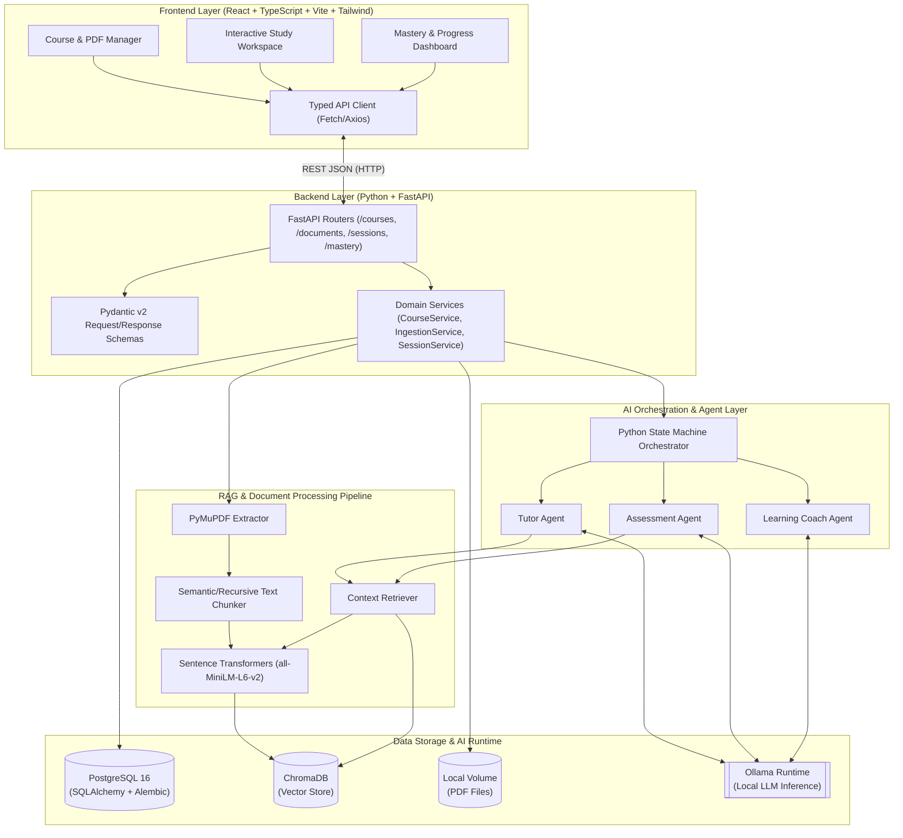
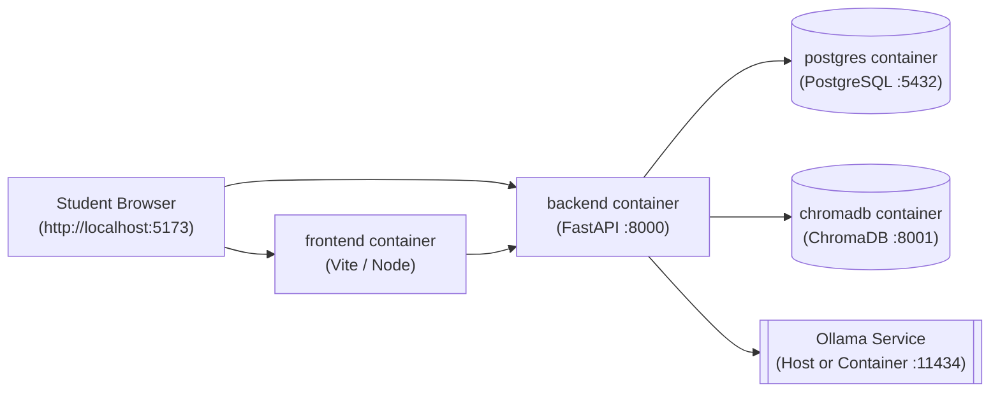

# Study Partner AI — System Architecture

## 1. High-Level Architectural Overview

Study Partner AI follows a **modular, layered architecture** with strict separation between the **Presentation Layer (React Frontend)**, **Application & API Layer (FastAPI Backend)**, **AI Orchestration & Agent Layer (State Machine + Agents)**, **RAG & Ingestion Pipeline**, and **Data Persistence Layer (PostgreSQL + ChromaDB + Local File Storage)**.



---

## 2. Layer Responsibilities & Boundaries

### 2.1 Frontend Layer (`frontend/`)
- **Technology:** React 18, TypeScript, Vite, Tailwind CSS.
- **Responsibilities:**
  - Render course workspaces, document ingestion statuses, concept mastery lists, and the interactive study session UI.
  - Reflect the current state of the backend Study Session State Machine (`TEACHING`, `QUESTIONING`, `EVALUATING`, `COACHING`) without embedding pedagogical business rules in the client.
  - Display structured rubric evaluations (score breakdowns, strengths, gaps) and source PDF page citations.
- **Boundary Rule:** The frontend communicates **exclusively** with the FastAPI backend via typed REST endpoints. It never talks directly to Ollama or ChromaDB.

### 2.2 Backend API & Domain Layer (`backend/app/`)
- **Technology:** Python 3.11+, FastAPI, Pydantic v2, SQLAlchemy 2.0, Alembic.
- **Responsibilities:**
  - Validate incoming HTTP requests and serialize responses using Pydantic v2 models.
  - Coordinate database transactions (PostgreSQL) and file storage operations.
  - Trigger synchronous or background PDF ingestion workflows.
  - Delegate study session progression to the AI Orchestrator and persist the resulting state transitions.
- **Boundary Rule:** FastAPI route handlers remain thin; business logic lives in Domain Services, and AI prompt/workflow logic lives in the AI Orchestration module.

### 2.3 RAG & Ingestion Pipeline (`backend/app/rag/`)
- **Technology:** PyMuPDF (`fitz`), Sentence Transformers, ChromaDB client.
- **Responsibilities:**
  - Parse uploaded PDF files page-by-page, cleaning headers/footers and normalizing whitespace.
  - Split page text into overlapping chunks (`chunk_size=800` chars, `chunk_overlap=150` chars) tagged with `course_id`, `document_id`, and `page_number`.
  - Compute dense embeddings locally via `SentenceTransformer("all-MiniLM-L6-v2")`.
  - Store and query chunks in ChromaDB with metadata filtering by `course_id` or `document_id`.

### 2.4 AI Orchestration & Agent Layer (`backend/app/ai/`)
- **Technology:** Python State Machine (MVP), Ollama REST/Python client, Pydantic output parsers.
- **Responsibilities:**
  - Manage the deterministic study session lifecycle via the **Orchestrator**.
  - Execute specialized agents (**Tutor Agent**, **Assessment Agent**, **Learning Coach**) with role-specific system prompts, RAG context injection, and structured JSON output enforcement.
- **Boundary Rule:** Agents are stateless workers that accept a well-defined `SessionContext` object and return a validated Pydantic output model. The Orchestrator and `SessionService` handle state persistence.

### 2.5 Data Storage Layer
- **PostgreSQL:** System of record for all structured entities (`courses`, `documents`, `concepts`, `study_sessions`, `session_messages`, `assessments`, `mastery_records`). Managed via SQLAlchemy 2.0 ORM and versioned with Alembic migrations.
- **ChromaDB:** Persistent vector store for document chunk embeddings and similarity search.
- **Local File Volume:** Stores raw uploaded PDFs under `/data/uploads/{course_id}/{document_id}.pdf`.

---

## 3. Backend Directory Structure

```text
study-partner/
├── docker-compose.yml
├── docs/                           # Architecture & project documentation
├── backend/
│   ├── Dockerfile
│   ├── pyproject.toml              # Dependencies & pytest config
│   ├── alembic.ini
│   ├── alembic/                    # Database migrations
│   ├── app/
│   │   ├── main.py                 # FastAPI app initialization & CORS
│   │   ├── config.py               # Pydantic Settings (DB, Chroma, Ollama URLs)
│   │   ├── database.py             # SQLAlchemy engine & session dependency
│   │   ├── models/                 # SQLAlchemy ORM models
│   │   ├── schemas/                # Pydantic request/response schemas
│   │   ├── api/                    # FastAPI routers
│   │   │   ├── courses.py
│   │   │   ├── documents.py
│   │   │   ├── concepts.py
│   │   │   └── sessions.py
│   │   ├── services/               # Business logic & DB coordination
│   │   │   ├── course_service.py
│   │   │   ├── ingestion_service.py
│   │   │   ├── session_service.py
│   │   │   └── mastery_service.py
│   │   ├── rag/                    # PDF extraction, chunking, embeddings, ChromaDB
│   │   │   ├── pdf_extractor.py
│   │   │   ├── chunker.py
│   │   │   ├── embedder.py
│   │   │   └── vector_store.py
│   │   └── ai/                     # Orchestrator, LLM client, and Agents
│   │       ├── llm_client.py       # Ollama wrapper with JSON retry validation
│   │       ├── orchestrator.py     # Python State Machine
│   │       ├── prompts/            # Prompt templates
│   │       └── agents/
│   │           ├── concept_extractor.py
│   │           ├── tutor_agent.py
│   │           ├── assessment_agent.py
│   │           └── learning_coach.py
│   └── tests/                      # pytest unit & integration suites
└── frontend/
    ├── Dockerfile
    ├── package.json
    ├── vite.config.ts
    ├── tailwind.config.js
    ├── src/
    │   ├── api/                    # Typed REST API functions
    │   ├── types/                  # TypeScript interfaces matching Pydantic schemas
    │   ├── components/             # Reusable UI components (RubricCard, PDFUploader, etc.)
    │   ├── pages/                  # CourseList, CourseDetail, StudySessionView
    │   └── App.tsx
    └── e2e/                        # Playwright E2E tests
```

---

## 4. Infrastructure & Deployment Topology (Docker Compose)



- **`postgres`:** Official `postgres:16-alpine` image with persistent named volume `pg_data` and healthcheck.
- **`chromadb`:** Official `chromadb/chroma` image with persistent volume `chroma_data`.
- **`backend`:** Python 3.11 container mounting `./backend` for hot-reload in dev and `uploads_data` volume for PDFs. Connects to Ollama via `http://host.docker.internal:11434` (or an optional `ollama` container).
- **`frontend`:** Node 20 container serving the React + Vite application on port `5173`.
