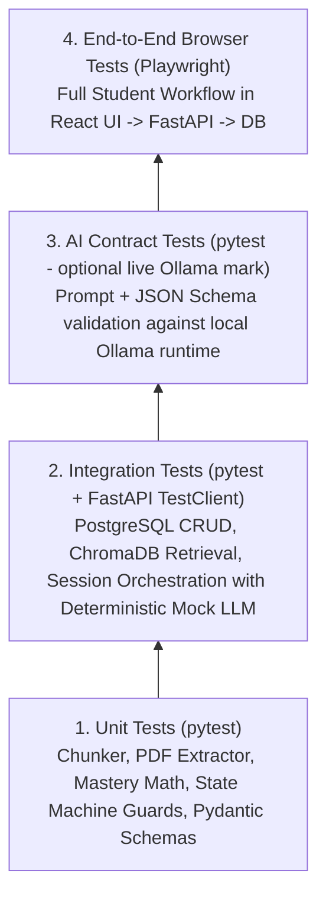

# Study Partner AI — Testing Strategy

## 1. Testing Philosophy
Every development phase has a mandatory verification gate before moving to the next phase. Because Study Partner AI combines deterministic backend logic, vector retrieval, non-deterministic local LLM inference, and an interactive React frontend, our testing strategy separates **fast, deterministic unit/integration tests** from **live LLM/E2E tests**.



---

## 2. Backend Testing (`pytest`)

### 2.1 Unit Tests (`backend/tests/unit/`)
Fast, isolated tests with zero external network calls:
- **PDF Extraction & Chunking (`test_rag_pipeline.py`):**
  - Verifies PyMuPDF extracts expected text and page numbers from a sample fixture PDF.
  - Verifies corrupted or empty PDFs raise `DocumentParseError`.
  - Verifies recursive chunker respects `chunk_size=800`, `chunk_overlap=150`, and preserves `page_number` metadata.
- **Mastery Calculation (`test_mastery_service.py`):**
  - Verifies first-attempt score assignment ($M_{\text{new}} = S_{\text{new}}$).
  - Verifies weighted moving average on subsequent attempts ($0.4 \cdot M_{\text{old}} + 0.6 \cdot S_{\text{new}}$).
  - Verifies status transitions (`NOT_STARTED`, `NEEDS_REVIEW`, `LEARNING`, `MASTERED`) at boundary values (`0`, `49.9`, `50.0`, `79.9`, `80.0`, `100.0`).
- **LLM JSON Retry Wrapper (`test_llm_client.py`):**
  - Verifies valid JSON parses into the target Pydantic schema on the first attempt.
  - Verifies malformed JSON triggers the retry mechanism with validation error feedback and succeeds on the second attempt.
  - Verifies persistent failure raises a clean `LLMOutputValidationError` after max retries.
- **State Machine Transitions (`test_orchestrator.py`):**
  - Verifies valid transitions (`IDLE -> TEACHING -> QUESTIONING -> EVALUATING -> COACHING -> TEACHING/QUESTIONING/COMPLETED`).
  - Verifies invalid actions (e.g., calling `submit_answer` while in `TEACHING` state) raise `InvalidSessionStateError`.

### 2.2 Integration Tests (`backend/tests/integration/`)
Tests service coordination across FastAPI, SQLAlchemy/PostgreSQL (or isolated test DB), and ephemeral ChromaDB client:
- **Course & Document Ingestion API (`test_ingestion_api.py`):**
  - Uploads a sample PDF via `POST /api/v1/courses/{id}/documents`.
  - Verifies chunks are stored and retrievable in ChromaDB.
  - Verifies `Concept` and `MasteryRecord` (`score=0.0`, `status=NOT_STARTED`) rows are persisted in the database.
  - Verifies deleting a course removes both database rows and ChromaDB vectors.
- **Study Session Full Lifecycle API (`test_session_api.py`):**
  - Uses a deterministic fake/mock `LLMClient` returning valid Pydantic fixtures for `TutorOutput`, `GeneratedAssessment`, `AssessmentEvaluation`, and `CoachRecommendation`.
  - Executes:
    1. `POST /api/v1/courses/{id}/sessions` $\rightarrow$ asserts state is `TEACHING` and `SessionMessage` is recorded.
    2. `POST /api/v1/sessions/{id}/practice` $\rightarrow$ asserts state is `QUESTIONING` and `Assessment` row is created with rubric JSON.
    3. `POST /api/v1/sessions/{id}/submit-answer` $\rightarrow$ asserts state is `COACHING`, rubric breakdown is saved, and `MasteryRecord` is updated.
    4. `POST /api/v1/sessions/{id}/next-step` $\rightarrow$ asserts transition to next concept or `COMPLETED`.

### 2.3 Live Ollama Contract Tests (`@pytest.mark.ollama`)
- Optional marker run when local Ollama is active (`pytest -m ollama`).
- Sends real RAG context chunks to Ollama for `ConceptExtractor`, `TutorAgent`, `AssessmentAgent`, and `LearningCoachAgent`, asserting that the live model produces valid Pydantic outputs within acceptable latency.

---

## 3. Frontend & End-to-End Testing (`Playwright`)

### 3.1 E2E Critical User Journeys (`frontend/e2e/study_workflow.spec.ts`)
Playwright tests verify the integrated application from the student's browser perspective:
1. **Journey 1 — Course Creation & PDF Onboarding:**
   - Student opens the app, creates a course (`"CS-301 Operating Systems"`), and uploads a sample lecture PDF.
   - UI displays `"READY"` document badge and renders the extracted list of concepts with `0%` (`NOT_STARTED`) mastery badges.
2. **Journey 2 — Guided Study & Rubric Assessment Loop:**
   - Student clicks **"Study Concept"** on a concept.
   - UI renders the **Tutor Agent's** explanation and cited page numbers.
   - Student clicks **"Practice This Concept"**.
   - UI displays the generated question and rubric criteria preview.
   - Student submits an answer in the text area.
   - UI renders the **Rubric Evaluation Card** (total score, per-criterion points/feedback, strengths, gaps), updated mastery progress bar, and the **Learning Coach** recommendation button.
3. **Journey 3 — Error Handling:**
   - Attempting to upload a non-PDF or empty file displays a user-friendly validation alert without crashing the session.

---

## 4. Test Execution Commands (Target Setup)

```bash
# Run all deterministic backend unit and integration tests
cd backend && pytest -v -m "not ollama"

# Run live Ollama AI contract tests
cd backend && pytest -v -m "ollama"

# Run Playwright End-to-End browser tests
cd frontend && npx playwright test
```

---

## 5. Phase 8 & Phase 9 Final Verification Summary
- **Backend Automated Suite (`pytest backend/tests`):** **40/40 passed** (including `backend/tests/test_auth.py` and `backend/tests/test_phase9_security_resilience_and_demo.py` covering ownership enforcement across every endpoint, input validation, secret/log confidentiality, complete course cascade deletion across DB + ChromaDB + disk, Ollama timeout & malformed output resilience, ChromaDB outage fallback, DB readiness outage, and the full 10-step demo workflow).
- **Frontend Static Analysis & Production Build:** `npm run lint` (0 errors, 0 warnings) and `npm run build` (`tsc -b && vite build` succeeding cleanly).
- **Playwright E2E Suite (`frontend/e2e/phase8.spec.ts` & `frontend/e2e/phase9_demo_workflow.spec.ts`):** **2/2 passed**, verifying all 12 screens, responsive mobile drawer navigation, dark mode toggle, `401 TOKEN_EXPIRED` auto-logout, and the complete 10-step reproducible student demonstration workflow.
- **Reproducible CLI Demonstration (`scripts/run_demo.py`):** Executes and verifies all 10 demonstration steps end-to-end against the real FastAPI + SQLAlchemy + PyMuPDF + ChromaDB stack.

